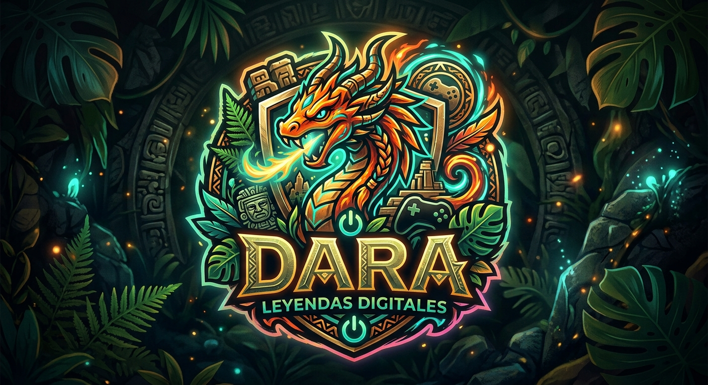

# erronka1
# 🎮 DARA — Página Web de Videojuegos

<p align="center">
  
</p>

<h3 align="center">🎮 Descubre. Explora. Juega. 🎮</h3>

<p align="center">
  <strong>Repositorio oficial de la página web de videojuegos DARA</strong>
</p>

<p align="center">
  
  
  
  
</p>

---

## 🕹️ Sobre DARA

**DARA** es una página web dedicada al mundo de los **videojuegos**, creada como proyecto por un equipo de tres integrantes.

Nuestro objetivo es desarrollar un sitio web visual, sencillo y entretenido donde los usuarios puedan explorar diferentes categorías relacionadas con el mundo gaming.

En este repositorio se encuentra el código fuente y los recursos utilizados para construir nuestra página web.

---

## 👥 Nuestro equipo

### 🚀 Creadores de DARA

| 👤 Integrante | 💻 Rol |
|---|---|
| 🎮 **Daymer** | Desarrollo y diseño |
| 🕹️ **Aimar** | Desarrollo y contenido |
| ⚡ **Ander** | Desarrollo y contenido |

> 💡 **DARA es un proyecto desarrollado conjuntamente por Daymer, Aimar y Ander.**

---

## 🎯 ¿Qué encontrarás en DARA?

Nuestra página está organizada en diferentes secciones para facilitar la navegación:

### ⚔️ Acción
Una sección dedicada a los videojuegos de **acción**, combates, aventuras y experiencias llenas de adrenalina.

### 🗺️ Aventura
Explora mundos, historias y experiencias dentro de nuestra selección de videojuegos de **aventura**.

### 🏆 Deportes
Una sección centrada en videojuegos relacionados con diferentes **deportes**.

### 🗺️ Mapas
Información y recursos relacionados con diferentes mapas y mundos de videojuegos.

---

## 🛠️ Tecnologías utilizadas

Para desarrollar DARA hemos utilizado principalmente:

<p align="center">


</p>

### 📂 Estructura del proyecto

```text
DARA_web/
│
├── 🏠 index.html
├── ⚔️ accion.html
├── 🗺️ aventura.html
├── 🏆 deportes.html
├── 🗺️ mapas.html
├── 🎨 style.css
└── 🖼️ logo.jpg
